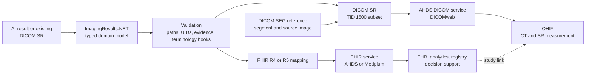

# From AI Measurement to Interoperable Clinical Evidence: Workflow and Demonstration

## Executive summary

Medical-imaging AI can calculate useful findings such as lesion diameter, volume, density, confidence, or change over time. A difficult industry problem outside producing the number is preserving enough context for another system or clinician to understand, verify, display, exchange, and reuse that number safely.

A result such as `14.2 mm` is incomplete unless it remains connected to:

- the patient, study, series, image, and frame from which it was derived;
- the anatomical finding and measurement method;
- the image coordinates or segmentation defining the measured region;
- the algorithm or observer that produced it;
- a stable tracking identity for longitudinal comparison;
- a representation that imaging systems and non-imaging clinical systems can consume.

**ImagingResults.NET** was built to demonstrate an end-to-end answer to that problem in .NET 11. The SDK models a quantitative imaging result once, writes a DICOM Structured Report based on a useful TID 1500 subset, retains references to source images and DICOM SEG objects, maps the result to FHIR R4 or R5, and can send the resulting artifacts to Azure Health Data Services (AHDS).

The workflow is designed as an interoperability baseline, not as a claim of complete DICOM template, terminology, clinical, or regulatory conformance.

## The real-world problem

Imaging AI commonly begins outside the systems that manage longitudinal patient care. A model may run in a container, research platform, cloud service, or modality-adjacent pipeline and produce proprietary JSON. That JSON can be excellent for the model developer but weak as durable clinical evidence.

Several integration problems follow:

1. **Loss of image context.** A scalar value in a database may not identify the exact image frame, region, or segmentation that produced it.
2. **Viewer fragmentation.** A radiologist should be able to inspect a result where images are reviewed, rather than reconstructing evidence from a separate AI portal.
3. **Semantic ambiguity.** A number needs coded meaning, coded units, method, finding site, and provenance before it can be compared or processed safely.
4. **EHR and analytics isolation.** DICOM is the native imaging exchange model, while many enterprise clinical workflows, data platforms, and decision support systems use FHIR.
5. **Longitudinal identity.** Findings need stable tracking identifiers so a lesion or region can be related across time points.
6. **Vendor coupling.** Proprietary payloads make migration, validation, and multi-vendor integration expensive.

The HL7 DICOM SR-to-FHIR project describes a closely related clinical problem: measurements captured in modalities or radiology workstations may otherwise be manually transcribed into diagnostic reports, which can lose fidelity and introduce errors. Its goal is to make structured imaging observations usable outside imaging infrastructure as FHIR resources.

## Why DICOM SR, TID 1500, DICOM SEG, and FHIR fit together

These technologies solve different parts of the same problem.

### DICOM SR and TID 1500

DICOM Structured Reporting stores coded clinical content as a structured tree inside a DICOM instance. TID 1500 is the general-purpose *Measurement Report* template for image-derived measurements and qualitative evaluations. Its related templates provide structures for measurement groups, planar regions, volumetric regions, numeric measurements, observation context, and evidence references.

The Imaging Data Commons describes SR-TID 1500 as a representation for generic image-based measurements with coded concepts, coded units, finding context, method, derivation, and references to segmentations and source images. This is directly aligned with the problem ImagingResults.NET addresses.

### DICOM SEG

DICOM SEG represents pixel- or voxel-level segmentations in the same imaging ecosystem as CT, MR, PET, and other source objects. A measurement report can reference a SEG instance and a specific segment, preserving the relationship between the numerical result and the region that was measured.

ImagingResults.NET currently models and writes **SEG references**. It does not generate segmentation pixel data or claim full Segmentation IOD conformance.

### FHIR

FHIR makes selected imaging results available to systems that do not process DICOM SR directly. The SDK maps the domain result to resources such as:

- `DiagnosticReport` for the report-level result;
- `Observation` for individual measurements;
- `ImagingStudy` for study context;
- `ImagingSelection` in R5 for selected instances and frames;
- `Provenance` for observer and algorithm context.

FHIR R4 does not have `ImagingSelection`, so the R4 adapter uses documented identifier-based evidence references and emits a warning that the mapping is lossier. The SDK keeps R4 and R5 adapters separate because the generated Firely model assemblies are release-specific.

## The implemented workflow



### TCIA interoperability demonstration

The real demonstration uses de-identified TCGA-KIRC subject `TCGA-BP-4343` from TCIA:

1. The case contributes 101 abdominal CT instances and one original Enhanced SR measurement report.
2. The CT and SR are stored together in a DICOMweb service: local Orthanc for the default demonstration or AHDS DICOM for the optional cloud path.
3. OHIF retrieves both directly from local Orthanc or through the authenticated local proxy for AHDS, navigates to the referenced source image, and displays the 66.44 mm measurement.
4. `Tid1500Reader` parses the original SR, including its legacy SRT Finding Site code and unnamed spatial/image content items.
5. The FHIR R4 mapping produces a de-identified `Patient`, `ImagingStudy`, `DiagnosticReport`, `Observation`, and `Provenance`.
6. A Medplum-compatible transaction imports those linked resources into the local FHIR server.
7. Medplum Provider displays the quantitative result in the patient timeline. The `DiagnosticReport` also carries a demo OHIF study URL so a customized EHR can offer an **Open in OHIF** action.

This is an evidence-preserving interoperability demonstration, not a complete clinical report. The source SR is a real crowdsourced research annotation with completion status `COMPLETE` and verification status `UNVERIFIED`. It records a length at the kidney, but does not establish what structure was measured or provide a diagnostic narrative.

OHIF and Medplum remain separate consumers in the current implementation. OHIF reads CT and SR objects from DICOMweb; it does not query the FHIR server. Medplum stores the structured clinical projection and links back to the OHIF study. Production integration would normally add shared authentication, authorization, audit, and launch context such as SMART on FHIR.

## Running and verifying the complete demonstration

### What the demonstration contains

| Scenario | Input | SDK path | Result to inspect |
| --- | --- | --- | --- |
| Local viewer | Bundled TCIA CT and Enhanced SR | Orthanc -> OHIF | The original 66.44 mm renal measurement on its referenced CT slice |
| FHIR projection | Bundled TCIA Enhanced SR | SR parser -> domain model -> FHIR R4 | Patient, ImagingStudy, DiagnosticReport, Observation, and Provenance |
| Local EHR | Generated FHIR R4 transaction | Medplum import | Linked clinical resources and the quantitative result |
| Optional Azure path | Bundled TCIA DICOM and mapped FHIR | Authenticated SDK clients -> AHDS | DICOMweb storage and FHIR transaction results |

### Fastest path: start everything locally

The complete local stack requires Docker Desktop, PowerShell, and available local ports `3000`, `3100`, `3101`, `8042`, and `8103`. Node.js, npm, Azure credentials, and a separate DICOM download are not required for this path. From the repository root, run:

```powershell
.\examples\demo-stack\start-demo.ps1
```

When startup completes, the principal endpoints are:

| Component | URL |
| --- | --- |
| TCIA study in OHIF | http://localhost:3000/viewer?StudyInstanceUIDs=1.3.6.1.4.1.14519.5.2.1.9203.4004.100545948082587796019777812429 |
| Medplum App | http://localhost:3100 |
| Sample Medplum Provider | http://localhost:3101 |
| Orthanc | http://localhost:8042 |

### Verify the TCIA OHIF scenario

Open the real TCIA study URL. Select the CT series, then drag the **SR Crowds Cure Cancer Annotation as Measurement Report** series onto the image viewport. OHIF should navigate to the referenced slice and display the green 66.44 mm renal measurement.

The repository contains the complete case under `examples/demo-data/tcia-tcga-bp-4343`:

- subject `TCGA-BP-4343`;
- Study Instance UID `1.3.6.1.4.1.14519.5.2.1.9203.4004.100545948082587796019777812429`;
- CT Series Instance UID `1.3.6.1.4.1.14519.5.2.1.9203.4004.178060436087844836988805217813`;
- 101 abdominal CT instances;
- one original Enhanced SR TID 1500 report;
- one radiologist-created renal long-axis measurement of approximately 66.44 mm.

The source report is a crowdsourced research annotation with completion status `COMPLETE` and verification status `UNVERIFIED`. It records a length at the kidney but does not identify the measured structure with a separate finding item and does not contain a narrative diagnosis.

### Verify the real FHIR and Medplum scenario

The startup script generates a Medplum-compatible FHIR R4 transaction from the bundled SR. To load it:

1. Open <http://localhost:3100>.
2. Create a local account and project.
3. Open <http://localhost:3100/batch>.
4. Import `artifacts\real-sample\fhir\real-renal-measurement-fhir-r4-transaction.json`.
5. Inspect the resulting Patient, ImagingStudy, DiagnosticReport, Observation, and Provenance.
6. Open <http://localhost:3101>, sign in with the same local account, and select `TCGA-BP-4343`.

The Observation contains `66.43856134 mm` and the kidney finding-site context. The DiagnosticReport groups the result and carries the source-study identifiers. Provenance identifies the source DICOM SR. The transaction uses POST entries and UUID full URLs so Medplum can assign resource IDs while resolving the internal references atomically.

FHIR R4 has no `ImagingSelection` resource. The mapper therefore represents the referenced DICOM SOP instance as an identifier-only `Observation.derivedFrom` reference and emits a diagnostic explaining that this mapping is less expressive than the R5 representation.

OHIF and Medplum are deliberately separate consumers. OHIF reads CT and SR objects from DICOMweb. Medplum stores the clinical FHIR projection and a study-specific OHIF URL. The demonstration does not imply that OHIF queries Medplum or that Medplum provides a specialized diagnostic-imaging presentation.

### Run the optional Azure Health Data Services path

The Azure path requires existing AHDS DICOM and FHIR services, an Entra identity with the applicable data-plane roles, and Azure CLI authentication or another credential supported by `DefaultAzureCredential`.

To upload the bundled TCIA DICOM case:

```powershell
$env:AZURE_TOKEN_CREDENTIALS = "AzureCliCredential"

dotnet run `
  --project examples\ImagingResults.AzureDemo `
  --configuration Release `
  -- `
  --dicom-directory examples\demo-data\tcia-tcga-bp-4343 `
  --dicom-service-url "https://<dicom-service>.dicom.azurehealthcareapis.com"
```

To parse the bundled SR and upload its FHIR R4 projection:

```powershell
$env:AZURE_TOKEN_CREDENTIALS = "AzureCliCredential"

dotnet run `
  --project examples\ImagingResults.AzureDemo `
  --configuration Release `
  -- `
  --fhir-from-dicom-sr examples\demo-data\tcia-tcga-bp-4343\measurement-report.dcm `
  --output-directory artifacts\real-sample\fhir `
  --fhir-service-url "https://<fhir-service>.fhir.azurehealthcareapis.com"
```

To view an AHDS-hosted study in OHIF without exposing an access token to the browser, run the authenticated local proxy:

```powershell
$env:AZURE_TOKEN_CREDENTIALS = "AzureCliCredential"
$env:AZURE_TENANT_ID = "<tenant-id>"

dotnet run `
  --project examples\ImagingResults.DicomWebProxy `
  -- `
  --dicom-service-url "https://<dicom-service>.dicom.azurehealthcareapis.com" `
  --urls http://localhost:5055
```

In another terminal, start OHIF:

```powershell
.\examples\ohif\start-ohif.ps1
```

The proxy obtains AHDS tokens through `DefaultAzureCredential` and adds them to server-side DICOMweb requests. The browser configuration contains no bearer token.

### Run the automated validation

The repository baseline is verified with:

```powershell
dotnet restore ImagingResults.sln
dotnet build ImagingResults.sln --configuration Release --no-restore
dotnet test ImagingResults.sln --configuration Release --no-build
dotnet pack ImagingResults.sln `
  --configuration Release `
  --no-build `
  --output artifacts\packages
```

The tests use synthetic data and cover domain validation, deterministic identifiers, DICOM writing and parsing, supported TID 1500 content, FHIR R4 and R5 mapping, Azure request construction, retry behavior, response parsing, and package-consumer compilation. Passing tests establish the behavior represented by those fixtures and assertions. They do not certify complete DICOM, FHIR, terminology, clinical, or regulatory conformance.

### Stop or reset the local stack

Stop containers while retaining Orthanc and Medplum data:

```powershell
.\examples\demo-stack\start-demo.ps1 -Stop
```

Stop containers and remove the named volumes:

```powershell
.\examples\demo-stack\start-demo.ps1 -Reset
```

## How this helps an industry workflow

### 1. It preserves evidence rather than only exporting a number

The report connects the measurement to the source SOP instance, frame, coordinates, SEG object, segment number, algorithm, and tracking identity. This creates a reviewable chain from result to evidence.

### 2. It supports imaging-native review

An SR is stored as a DICOM instance alongside the study. Viewers still need specific SR support, but this is a real implemented workflow rather than a theoretical one. OHIF documents the ability to save tracked measurements as DICOM SR, reload stored SR, and rehydrate measurements into interactive viewer tools.

### 3. It bridges imaging and enterprise clinical data

The DICOM object remains the imaging-native source of evidence, while the FHIR projection can support EHR integration, analytics, registries, cohort selection, workflow orchestration, and decision support. This avoids forcing a single representation to solve every integration problem. The FHIR result is not merely display text: the measurement value, UCUM unit, coded meaning, anatomical site, study identifiers, evidence reference, report relationship, and provenance remain machine-readable.

### 4. It reduces custom integration code

The application works with typed concepts such as `UcumQuantity`, `TrackingIdentifier`, `SopInstanceReference`, and `SegmentationReference` rather than hand-building nested DICOM datasets and FHIR resources for every model.

### 5. It creates explicit quality boundaries

Validation failures are reported with paths and stable codes. Best-effort FHIR mappings emit diagnostics when the target FHIR release cannot express the source evidence exactly. Azure responses expose per-instance failures and warnings. This is safer than success-shaped fallbacks or silently discarded context.

## Glossary

| Term | Meaning |
| --- | --- |
| **AHDS** | **Azure Health Data Services**, a Microsoft Azure service family for storing and exchanging healthcare data through standards such as FHIR and DICOMweb. |
| **AI** | **Artificial intelligence**. In this workflow, an algorithm that analyzes medical images and produces findings, measurements, coordinates, or segmentation results for review. |
| **DICOM** | **Digital Imaging and Communications in Medicine**, the principal standard for medical images and related imaging information. |
| **DICOM SEG** | A DICOM Segmentation object containing pixel- or voxel-level masks for one or more labeled regions. A measurement report can reference a specific numbered segment within the object. |
| **DICOM SR** | **DICOM Structured Reporting**, a structured DICOM document format for coded observations, measurements, spatial coordinates, and references to source images or segmentations. |
| **DICOMweb** | Web-based DICOM services that use HTTP for querying, retrieving, and storing DICOM objects. |
| **EHR / EMR** | **Electronic health record / electronic medical record**, the clinical system used to manage longitudinal patient information, reports, results, orders, and care workflows. |
| **FHIR** | **Fast Healthcare Interoperability Resources**, an HL7 standard for exchanging clinical data through resources and APIs. |
| **FHIR R4 / R5** | Different releases of the FHIR specification. The SDK keeps their adapters separate because resource structures and generated model types differ between releases. |
| **HL7** | **Health Level Seven International**, the standards organization responsible for FHIR and other healthcare interoperability standards. |
| **Medplum** | An open-source FHIR platform used in the demonstration as a sample EHR-facing clinical data store and application environment. |
| **OHIF** | **Open Health Imaging Foundation Viewer**, an open-source web viewer used to display DICOM studies and supported structured imaging results. |
| **PACS** | **Picture Archiving and Communication System**, the clinical infrastructure commonly used to store, retrieve, distribute, and review medical images. |
| **QIDO-RS** | **Query based on ID for DICOM Objects by RESTful Services**, the DICOMweb service used to search for studies, series, and instances. |
| **RIS** | **Radiology Information System**, a system used to manage radiology orders, scheduling, worklists, reporting, and operational workflows. |
| **SEG reference** | A reference from a measurement or report to a particular segment number in a separate DICOM SEG instance. It identifies the mask but does not contain the mask pixels itself. |
| **SOP Class UID** | A DICOM unique identifier that specifies the type of an object, such as CT Image Storage, Segmentation Storage, or Comprehensive SR Storage. |
| **SOP Instance UID** | A globally unique DICOM identifier for one specific object instance, such as an individual image, segmentation, or structured report. |
| **STOW-RS** | **Store Over the Web by RESTful Services**, the DICOMweb service used to upload DICOM objects. |
| **TCIA** | **The Cancer Imaging Archive**, a public, de-identified cancer-imaging repository funded by the U.S. National Cancer Institute. It hosts DICOM imaging collections that may also include segmentations, annotations, clinical data, or pathology information. |
| **TID 1500** | The DICOM **Measurement Report** template used to represent image-derived quantitative measurements and qualitative evaluations with coded context and evidence references. |
| **Tracking Identifier / Tracking UID** | A human-readable identifier and a globally unique DICOM identifier used together to maintain the identity of a finding or region across reports and time points. |
| **UCUM** | **Unified Code for Units of Measure**, the unit-code system used for machine-readable quantities such as millimeters, cubic millimeters, or standardized uptake values. |
| **UID** | **Unique Identifier**, the globally unique numeric identifier format used throughout DICOM for studies, series, instances, tracking identities, and other objects. |
| **WADO-RS** | **Web Access to DICOM Objects by RESTful Services**, the DICOMweb service used to retrieve DICOM studies, series, instances, frames, or rendered content. |

<details>
<summary>Demonstration evidence and licensing</summary>

Synthetic fixtures remain in the automated test suite and are repository-owned test data, not clinical data. They are not loaded by the demonstration stack. The demonstrated TCIA case is de-identified research data redistributed under CC BY 3.0 from Crowds Cure Cancer: Crowdsourced data collected at the RSNA 2017 annual meeting and its source CT collection TCGA-KIRC.

Required data citation:

`Kalpathy-Cramer, J., Beers, A., Mamonov, A., Ziegler, E., Lewis, R., Almeida, A. B., Harris, G., Pieper, S., Sharma, A., Tarbox, L., Tobler, J., Prior, F., Flanders, A., Dulkowski, J., Fevrier-Sullivan, B., Jaffe, C., Freymann, J., & Kirby, J. (2019). Crowds Cure Cancer: Crowdsourced data collected at the RSNA 2017 annual meeting [Data set]. The Cancer Imaging Archive. https://doi.org/10.7937/K9/TCIA.2018.OW73VLO2`

Source CT citation:

`Akin, O., Elnajjar, P., Heller, M., Jarosz, R., Erickson, B. J., Kirk, S., Lee, Y., Linehan, M. W., Gautam, R., Vikram, R., Garcia, K. M., Roche, C., Bonaccio, E., & Filippini, J. (2016). The Cancer Genome Atlas Kidney Renal Clear Cell Carcinoma Collection (TCGA-KIRC) (Version 3) [Data set]. The Cancer Imaging Archive. https://doi.org/10.7937/K9/TCIA.2016.V6PBVTDR`


The demonstration is not a substitute for clinical care and does not independently verify the diagnostic meaning of the research annotation.

</details>
